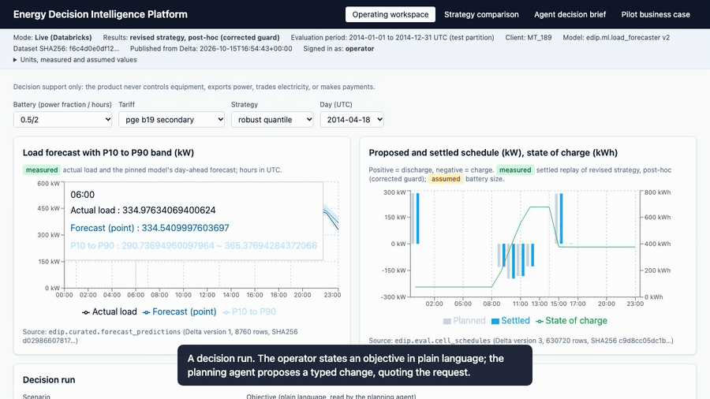
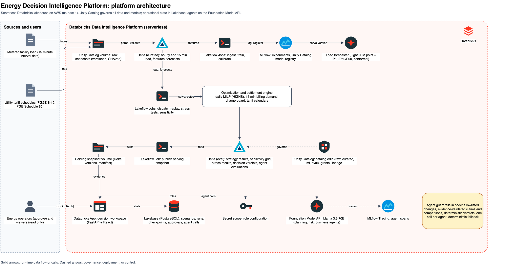
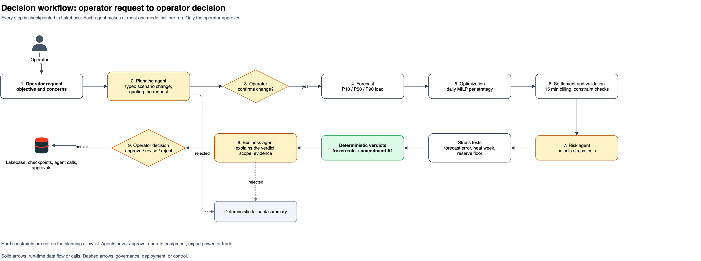
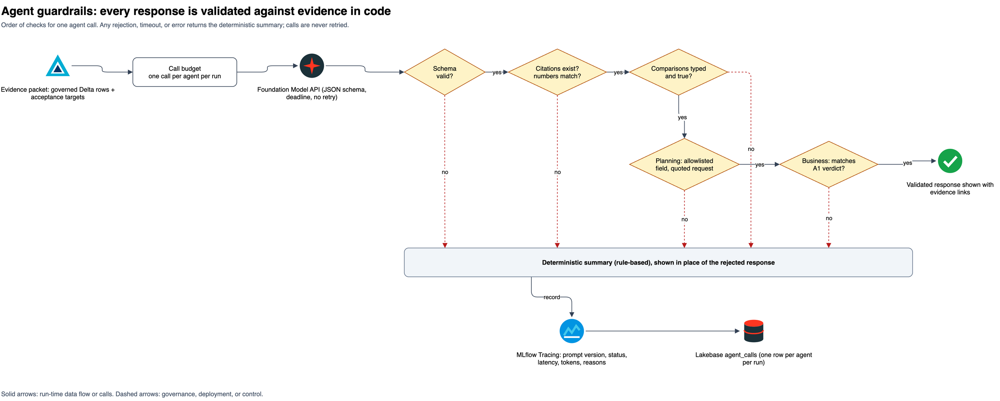
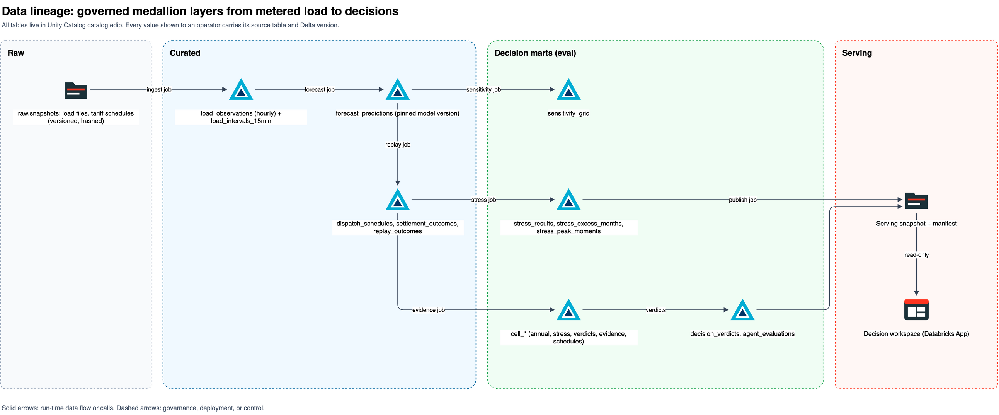
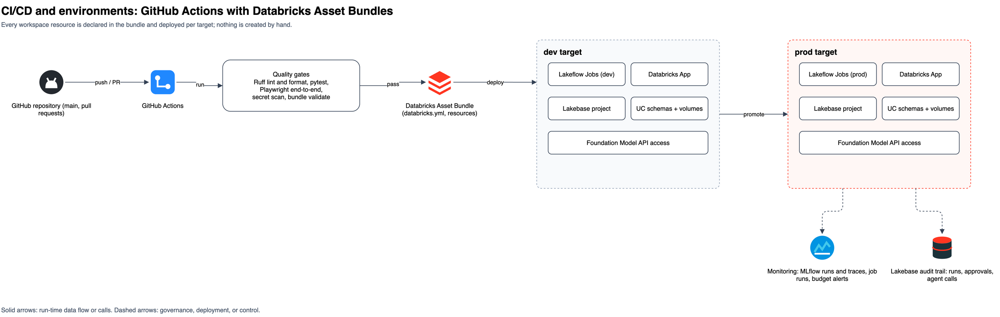
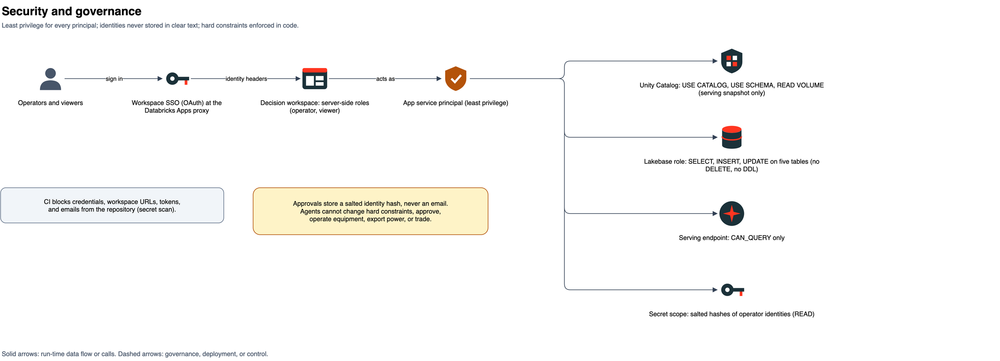

# Energy Decision Intelligence Platform

[](https://github.com/abh2050/energy-decision-ai-databricks/actions/workflows/ci.yml)
[](https://github.com/abh2050/energy-decision-ai-databricks/actions/workflows/pages.yml)

[](LICENSE)

**A product evaluation that reached a defensible "no" for a battery purchase and a scoped
"revise" for battery scheduling.** It was built end to end on Databricks:
- **Data and models:** Unity Catalog, Delta, Lakeflow Jobs, and the MLflow model registry.
- **Optimization:** a daily mixed integer program settled against real 15 minute billing.
- **Operations:** a Databricks App with Lakebase state.
- **Agents:** three bounded agents on the Foundation Model API, gated by deterministic
  rules and evaluated against a numbers-only baseline.



- **Website** (the evaluation as a presentation: demo video, architecture, results, recommendation): <https://abh2050.github.io/energy-decision-ai-databricks/>
- **App** (the forecaster and optimizer running in your browser, with recorded agent runs): <https://abh2050.github.io/energy-decision-ai-databricks/app/>
- **Results export** (every Delta table and the app's operational records): [release `results-2026-10-15`](https://github.com/abh2050/energy-decision-ai-databricks/releases/tag/results-2026-10-15)

## Project summary

**Energy Decision Intelligence Platform | AI Product Strategy, Databricks & MLOps**

Architected and evaluated an end-to-end AI decision intelligence platform for battery storage investment and operational scheduling, integrating Databricks, Unity Catalog, MLflow, optimization, and governed LLM agents.

- Evaluated six scheduling strategies across 540 sensitivity configurations using real metered load and utility tariffs.
- Built an auditable ML and agentic decision workflow with deterministic business rules, evidence validation, human approvals, and persistent execution records.
- Demonstrated that an agentic approach did not outperform a numbers-only baseline on held-out recommendation accuracy, informing a more cost-conscious product strategy.
- Produced an investment recommendation supported by financial modeling, stress testing, model evaluation, and documented acceptance criteria.

**Key outcome:** Identified a financially unfavorable battery investment despite positive modeled operating savings, demonstrating evidence-led AI product decision-making.

## Headline finding

1. **Do not buy a battery for this load profile.**
   - On PG&E B-19 at published rates, robust dispatch (planning peaks on the P90
     forecast) beats having no battery at every battery size tested, from +3,198 to
     +37,363 USD per year before capital cost.
   - No size recovers its installed cost within 15 years at the mid NREL ATB cost. The
     best case is a 30.8 year payback with an NPV of −829,491 USD.
   - On Portland General Electric (PGE) Schedule 85, nothing forecast-driven beats no
     battery at base costs.
2. **If a battery already exists, run robust dispatch and fix the maximum demand guard
   before a pilot.**
   - Every battery size breaches at least one stress limit.
   - For the base battery (50 percent of the 751.8 kW training peak, 2 hours) the
     deterministic verdicts are: frozen rule **revise**; with amendment A1 (dated,
     stricter) **revise**.
3. **The agents matched, but did not beat, the numbers-only path on held-out scenarios.**
   - Both paths scored 90 percent recommendation accuracy on 10 held-out scenarios.
   - Supported claims reached 92.9 percent against a 95 percent target.
   - Their measured value is translating plain-language objectives into typed scenario
     changes. On development scenarios that needed such a change, the agent path was
     right in 7 of 8 and the numbers-only path in 2 of 8. The held-out set barely tests
     this: both paths scored 3 of 4 there.
   - The decisions themselves come from deterministic rules, not from the agents.

Sources: [docs/business_case.md](docs/business_case.md), [docs/gates/gate6_review.md](docs/gates/gate6_review.md), [docs/gates/](docs/gates/).

## Results

All figures are USD per year before tax, against no battery, for the 2014 test year
(revised strategy, post-hoc, corrected guard). Sources: Delta `edip.eval.cell_annual`,
`edip.eval.sensitivity_grid`, `edip.eval.agent_evaluations`, and the
[results export](https://github.com/abh2050/energy-decision-ai-databricks/releases/tag/results-2026-10-15).

**PG&E B-19, base battery (50 percent of the 751.8 kW training peak, 2 hours)**

| Strategy | Annual bill | Net benefit vs no battery | Battery throughput (kWh) | Constraint violations |
|---|---:|---:|---:|---:|
| No battery | 905,027 | 0 | 0 | 0 |
| Fixed schedule | 913,874 | −14,727 | 196,004 | 0 |
| Seasonal forecast | 902,414 | −5,726 | 115,696 | 0 |
| ML forecast | 899,836 | −3,159 | 116,076 | 0 |
| **Robust quantile** | **890,773** | **+5,645** | 124,737 | 0 |
| Hindsight (ceiling) | 860,948 | +40,201 | 129,256 | 0 |

**Net benefit by battery size (base costs, before capital)**

| Battery (share of peak / hours) | B-19 fixed | B-19 ML | B-19 robust | B-19 hindsight | PGE robust |
|---|---:|---:|---:|---:|---:|
| 25% / 2 h | −1,383 | −8,474 | +3,198 | +23,431 | −2,460 |
| 25% / 4 h | +6,786 | −3,754 | +5,346 | +37,177 | −1,924 |
| 50% / 2 h | −14,727 | −3,159 | +5,645 | +40,201 | −2,235 |
| 50% / 4 h | −8,754 | −279 | +14,448 | +57,947 | −1,275 |
| 100% / 2 h | −14,116 | −2,991 | +11,455 | +49,416 | −2,808 |
| 100% / 4 h | −9,253 | +4,477 | +37,363 | +85,600 | −3,094 |

**Capital (mid NREL ATB cost, 15 year life, 8 percent discount rate, assumed):** no
non-hindsight strategy pays back within 15 years. The best case is robust dispatch at
100 percent / 4 h: 1,149,297 USD installed, a 30.8 year payback, and an NPV of
−829,491 USD ([business_case_capital.md](docs/business_case_capital.md)).

**Agent evaluation, final configuration** (business v3, planning v3, risk v2; 30
development scenarios, which shaped the prompts and are therefore optimistic, and 10
held-out scenarios)

| Metric | Development, agents | Development, numbers only | Held-out, agents | Held-out, numbers only |
|---|---:|---:|---:|---:|
| Recommendation accuracy | 96.7% | 80.0% | 90.0% | 90.0% |
| Supported claims (original definition; target 95%) | 99.1% | 99.3% | 92.9% | 100% |
| Supported claims (stricter definition) | 98.0% | 96.3% | 90.2% | 97.8% |
| Citation accuracy | 100% | 100% | 100% | 100% |
| Stress test selection | 100% | n/a | 100% | n/a |
| Prohibited actions refused by the agent | 80% | n/a | 100% | n/a |
| Cost per run | 0.0060 USD | 0.0021 USD | 0.0062 USD | 0.0021 USD |

## Decision log (product owner)

| Date | Decision | Why it mattered | Record |
|---|---|---|---|
| 2026-10-14 | **Froze the acceptance targets** before the first replay (SHA pinned by a test) | No target could be moved to fit a result | [gate3.md](docs/gates/gate3.md), [acceptance_targets.yaml](config/acceptance_targets.yaml) |
| 2026-10-14 | **Kept the pre-registered loss.** The strategies as first specified lost 56,000 to 65,000 USD per year on B-19, because day-ahead charging set new demand peaks | The negative result stays in the record next to every later result | [gate3.md](docs/gates/gate3.md) |
| 2026-10-14 | **Approved one post-hoc revision.** A settlement charge guard and P90 charge planning, tuned on July to December 2013 only, run once on 2014, and labelled post-hoc | Separates what was predicted from what was fixed afterwards | [gate3.md §8](docs/gates/gate3.md) |
| 2026-10-15 | **Added amendment A1.** A pilot needs positive net benefit over both no battery and the fixed schedule | The frozen target compared against a fixed schedule that itself lost money | [business_case.md](docs/business_case.md#amendment-a1-2026-10-15-owner-decision), [gate5.md](docs/gates/gate5.md) |
| 2026-10-15 | **Corrected the guard defect and kept the defective results.** The guard had carried the highest month-start peak forward. It was corrected to start each month at the previous month's billed demand; the earlier results are relabelled, and the settings tuned under the defect were not retuned | Disclosed its own mistake and its effect (robust dispatch moved from −3,006 to +5,645 USD per year) | [gate5.md](docs/gates/gate5.md), [gate6_review.md](docs/gates/gate6_review.md) |

## Architecture

Editable source: [docs/architecture.drawio](docs/architecture.drawio) (draw.io, six pages; generated by
[scripts/build_drawio.py](scripts/build_drawio.py)). SVG versions are in [docs/diagrams/](docs/diagrams/).

### Platform architecture


### Decision workflow


### Agent guardrails


### Data lineage


### CI/CD and environments


### Security and governance


## What it does

1. **Data:** real load for one client (UCI ElectricityLoadDiagrams20112014, client MT_189),
   billed on PG&E B-19 and PGE Schedule 85 tariffs encoded from the official sheets.
2. **Forecasting:** LightGBM point and P10, P50, P90 quantile models with conformal
   calibration (test P10 to P90 coverage 80.5 percent), registered in the Unity Catalog
   model registry.
3. **Dispatch and settlement:** a daily mixed integer program per strategy (no battery,
   fixed schedule, seasonal forecast, ML forecast, robust quantile, hindsight), settled
   against actual 15 minute load with tariff billing demand and a charge guard.
4. **Sensitivity and stress:** 540 grid cells and three predefined stress tests.
5. **Agents:** planning (a typed scenario change, quoting the operator), risk (chooses
   stress tests), and business (restates the deterministic verdict).
   - One call each.
   - Every number and comparison is validated against evidence rows.
   - Any rejected response falls back to a deterministic summary.
6. **Decision workspace:** FastAPI and React on Databricks Apps, with operator and viewer
   roles enforced on the server and Lakebase state.

## Observability: what was traced where

- **MLflow runs** (parameters, metrics, artifacts, dataset and config hashes) recorded
  data ingestion, forecaster training and calibration, the replays, and the sensitivity
  grid. These ran as Lakeflow Jobs, and the grid slices ran locally with a Databricks
  aggregate job. The forecaster is registered in the Unity Catalog model registry.
- **MLflow traces** of agent calls come from the agent evaluation runs (the harness runs
  against the Foundation Model API; experiment `/Shared/edip/gate5_agents`).
  - Each span records the prompt version, status, latency, tokens, and validator
    rejection reasons.
  - The website's trace excerpts come from these runs.
- **The live app's agent calls** received MLflow trace IDs, but the trace data did not
  upload: Databricks Apps could not reach the workspace storage endpoint.
  - For every live call, Lakebase table `agent_calls` holds the prompt version, status,
    latency, tokens, rejection reasons, and trace ID, one row per agent per run.
  - Lakebase also holds the run checkpoints and approvals.
  - These records are in the results export.

## Reproduce it

**Prerequisites:**
- A Databricks workspace with serverless compute, Unity Catalog, Databricks Apps,
  Lakebase, and Foundation Model API access.
- The Databricks CLI with a configured profile.
- `uv`, Python 3.12, and Node 22.

```bash
uv sync --all-extras && (cd frontend && npm ci)
uv run python scripts/create_catalog.py --profile <profile>   # catalog edip on managed storage
databricks bundle deploy -t dev -p <profile>                   # schemas, volumes, jobs, Lakebase, app
# Upload the UCI zip and tariff PDFs to /Volumes/edip/raw/snapshots (serverless jobs have no internet egress)
databricks bundle run gate1_ingest -t dev -p <profile>
databricks bundle run gate2_forecasting -t dev -p <profile> && databricks bundle run gate2_calibrate -t dev -p <profile>
databricks bundle run gate3_replay -t dev -p <profile> && databricks bundle run gate3_replay_revised -t dev -p <profile>
uv run python scripts/fetch_tables.py <tables_dir> && uv run python scripts/run_grid_local.py <tables_dir> <grid_dir>
databricks bundle run gate4_aggregate -t dev -p <profile> && databricks bundle run gate5_stress -t dev -p <profile>
uv run python -m edip.eval.cells_job --tables <tables_dir> --out <cells_dir>   # then gate6_load_cells, gate6_publish
uv run python scripts/apply_lakebase_ddl.py && uv run python scripts/grant_app.py --profile <profile>
databricks bundle run edip_live -t dev -p <profile>
databricks bundle destroy -t dev -p <profile>                  # teardown
```

**Secrets and settings:**
- Secret scope `edip`, key `operator_hashes`: a comma-separated list of salted SHA256
  identity hashes from `edip.api.auth.identity_hash`. No email is ever stored.
- The CLI profile supplies workspace authentication. Nothing is read from the repository.

**Cloud cost:** about 9 USD at Databricks list price for the whole build, measured in
`system.billing.usage` from 2026-10-13 to 2026-10-15 (billing records can lag by a few
hours).
- Jobs 6.44 USD, model serving 1.10, SQL 1.03, and under 0.50 for the rest.
- This includes every rerun made during development.
- One 40-scenario agent evaluation costs about 0.33 USD in model calls.

## Assumptions

All assumed values are labelled "assumed" in the UI:
- **Battery:** size is set relative to the training peak; 90 percent round-trip
  efficiency, a 10 to 90 percent state of charge window, and a 50 percent terminal
  reserve.
- **Costs:** degradation 0.03 USD per kWh discharged; operating cost 4,868 USD per year.
- **Capital:** NREL ATB 2025 installed cost, a 15 year life, and an 8 percent discount
  rate.
- **Stress tests:** forecast errors doubled, a heat week of 1.10 times load, and a 30
  percent reserve floor.
- **Tariffs:** savings are before tax; PGE Schedule 108 is applied as a 1.015 multiplier;
  fixed charges and percentage taxes are excluded.

## Limitations

- **One client, one test year (2014),** and no weather data.
- **The forecasters are trained once on 2012 to mid 2013 and not refit,** so measured
  forecast error is likely pessimistic for later test months. A production system would
  retrain monthly on a rolling window.
- **The revised strategy is post-hoc.** Its settings were tuned under the guard defect
  and not retuned. Charging can still set a new monthly maximum demand under the guard's
  month-start limit (business case note 10).
- **Agents:** see headline finding 3. Not every frozen agent target is met; see
  [gate6_review.md](docs/gates/gate6_review.md).
- **Scenario evidence for the agent evaluation is scripted** (labelled), partly from the
  corrected replay.
- **The sandbox's own schedules are simplified.** They are planned and settled hourly in
  the browser, without 15 minute billing or the charge guard, and the page says so next
  to the result. The evaluated figures are in the results views and in this README.

## Repository

- [docs/PRD.md](docs/PRD.md): requirements.
- [CLAUDE.md](CLAUDE.md): build instructions.
- [docs/gates/](docs/gates/): one report per stage gate.
- [docs/architecture.drawio](docs/architecture.drawio): the architecture diagrams.
- [src/edip/](src/edip/): Python (core, data, forecasting, replay, agents, workflow, store, API).
- [frontend/](frontend/): the React app (live and browser builds) and the website, with Playwright tests in `e2e` and `e2e-public`.
- [evals/](evals/): 30 development and 10 held-out agent scenarios, with the harness.

## License and data

Code: [Apache License 2.0](LICENSE).

Data: Trindade, A. (2015). ElectricityLoadDiagrams20112014. UCI Machine Learning
Repository. https://doi.org/10.24432/C58C86 (CC BY 4.0).
